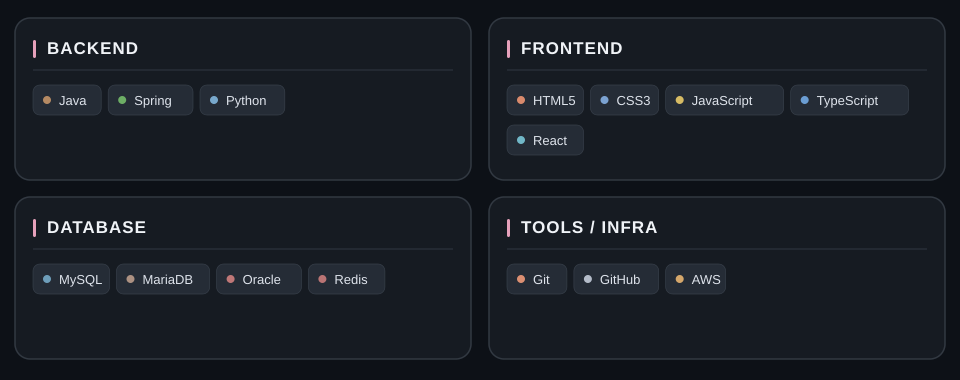

R A B B I T H A R U

### Hello, I'm R_H.

**Software Developer** &nbsp;·&nbsp; Web Development

<code>Code</code> &nbsp;·&nbsp; <code>Games</code> &nbsp;·&nbsp; <code>VRC</code>

---

### 01. Tech Stack

### 02. GitHub Activity

 

### 03. Featured Projects

  

---

R_H &nbsp; / &nbsp; RabbitHaru

